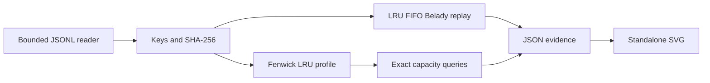

# TraceCache

**Find the cache capacity your observed workload can actually use.**

TraceCache is an offline Python library and CLI for equal-sized-object caches. It computes an exact
LRU miss curve, compares FIFO/LRU with offline-optimal Belady, and finds the smallest LRU capacity
that meets a chosen miss ratio on the supplied trace. Reports include a trace fingerprint, cold
miss floor and cold-start or continuously warmed phase windows. It reads JSONL or CSV, including
gzip-compressed inputs, and can recompute a saved report to verify its contents. No API key, GPU,
server or runtime dependency.


## Why it is useful

Increasing cache capacity cannot eliminate compulsory first-reference misses. A replacement policy
can also leave recoverable hits on the table. The tool separates those two effects and exposes the
assumptions behind its answer. It does not predict future demand, estimate dollars saved, or
recommend deploying an oracle with knowledge of future requests.

## Install and run

Requires CPython **3.13 or newer**. Tested locally on Windows 11 / Python 3.13.5. The 0.1 baseline's
four hosted Windows/Linux and Python 3.13/3.14 jobs passed in the
[verified CI run](https://github.com/Sarbajit-Sengupta/tracecache/actions/runs/41317805232).
The 0.2 changes have a separate validation record in [evidence/NOV2.md](evidence/NOV2.md).

```powershell
git clone https://github.com/Sarbajit-Sengupta/tracecache.git
cd tracecache
python -m venv .venv
.venv\Scripts\python -m pip install -e .
.venv\Scripts\tracecache examples/scan.jsonl --capacities 0,1,2,3,4,5 --target 0.5
```

On Linux/macOS use `.venv/bin/python` and `.venv/bin/tracecache`.

Write an evidence report and a standalone chart:

```powershell
.venv\Scripts\tracecache examples/scan.jsonl --capacities 0,1,2,3,4,5 --target 0.5 --window 6 --output report.json --svg curve.svg
```

The example has **11 requests, 5 distinct objects**. Its minimum capacity for an observed miss
ratio at most 0.5 is **5 objects**. Capacity 2 has 7 LRU misses; capacity 5 has 5. Those numbers are
reproduced in [the checked example report](evidence/example-report.json).

### Input contract

One UTF-8 JSON object per line, with exactly one field and a nonempty string key:

```json
{"key":"object-a"}
{"key":"object-b"}
{"key":"object-a"}
```

Blank lines, duplicate fields, extra fields, nonstring keys and invalid JSON fail with a diagnostic.
An empty file is valid and has zero misses and miss ratio 0. CRLF and a missing final newline work.
Keys are limited to 4096 characters; each line to 65,536 bytes including its newline; input to
128 MiB and one million requests by default. `--max-requests` changes the request cap. Increasing
it can use substantially more RAM. These bounds do not make the parser a hostile-code sandbox.

CSV input uses `--format csv` and exactly one header column named `key`. Standard CSV quoting,
commas and newlines within quoted keys are supported; blank rows and extra columns are rejected.
A header-only CSV is a valid empty trace. Files ending in `.gz` are decompressed incrementally;
both file size and decompressed content are bounded. The fingerprint and `trace_bytes` describe
the **decompressed bytes**, so plain and gzipped copies of identical content have the same identity.
The format is recorded separately, and keys still have the same validation limits.

```powershell
.venv\Scripts\tracecache trace.csv.gz --format csv --capacities 8,32,128
```

Capacities count **objects, not bytes**, and must be nonnegative integers. Up to 128 capacities
can be selected. A target is a finite miss ratio in [0,1]. An unreachable target produces
`"minimum_lru_capacity": null`, rather than an invented estimate. Reports contain counts and
fingerprints, not request keys or input paths. A fingerprint is not anonymization: dictionary
attacks can identify predictable traces, and callers must review artifacts before sharing them.

Exit 0 means analysis/verification completed; exit 1 means verification found a mismatch; exit 2
means an input, option or IO error. Files are local and no network is contacted. Input and output
paths must refer to distinct files, including hard-link aliases. Selected output files are replaced
atomically after the full contents are flushed, preserving the old file if the write fails before
replacement. Multi-file output is not transactional, and no power-loss durability guarantee is made. Never
interpret a preexisting file as evidence that a failed new command completed; check the exit code
and trace fingerprint.

### Warmed phases and report verification

`--window 1000 --window-mode warm` carries LRU state across windows. Each window then reports the
misses incurred during that interval; summing them yields the whole-trace count at that capacity.
The default `--window-mode cold` retains independent cold-start analysis.

```powershell
.venv\Scripts\tracecache examples/scan.jsonl --capacities 0,2,5 --window 6 --window-mode warm --output warm.json
.venv\Scripts\tracecache examples/scan.jsonl --verify warm.json
```

Verification uses the saved report's capacities, target and phase options, recomputes every field
and checks the fingerprint. For CSV sources also specify `--format csv`. Verification reads reports
up to 1 MiB; it requires the current tool version and schema 2. Regenerate old schema-1 reports.
It is a consistency check, not a signature or proof that a trace came from a trustworthy collector.
Output options cannot be combined with verification.

## How it works



The profiler maintains one active marker at each object's last reference position in a Fenwick
tree. On reuse, the number of more-recent distinct objects is its stack distance `d`. A fully
associative LRU cache hits exactly when `capacity > d`. A distance histogram and cumulative counts
allow capacity queries without replaying the trace for every size.

| Component | Time | Auxiliary space |
|---|---|---|
| Exact LRU profile | O(N log N) | O(N+U) |
| LRU capacity query | O(log D) | O(1) |
| Minimum-capacity query | O(log U log D) | O(1) |
| LRU/FIFO simulation, one capacity | O(N) | O(min(C,U)) |
| Belady, one capacity | O(N log(C+1)) amortized | O(N+U+C) |

N is requests, U distinct objects, D observed distance bins, C capacity. Input storage is additional.
The Belady heap uses lazy invalidation and periodic compaction to prevent unlimited heap growth on
long hit streaks. Its next-use array retains O(N) state. The CLI replays FIFO and Belady for each
selected capacity, except zero/full-fit boundaries whose counts are known from the profile. Whole-command
performance therefore differs from profiling-only benchmark results.

### Model and limitations

- Initially empty, fully associative caches, equal object sizes, no TTL, invalidations, prefetch,
  admission rejection, writes or variable retrieval costs; mandatory insertion after a miss.
- Belady's optimality applies to this equal-sized paging model. It is an offline bound, not a
  practical online replacement policy or an optimal variable-size cache algorithm.
- Cold window analysis restarts each cache. Use warm mode for interval misses in a continuously
  warmed global simulation; each mode is explicitly identified in the report.
- Exact processing retains the trace and an O(N) tree. This is not a streaming billion-request
  analyzer. Input caps constrain ordinary use, not every possible memory/time exhaustion case.
- No original cache algorithm is claimed. This is an original implementation and engineering
  artifact built around classical methods. It is not a replacement for native high-throughput
  simulators or an independently validated production service.

## Library example

```python
from tracecache import profile_lru, simulate

trace = ["a", "b", "a", "c", "a"]
profile = profile_lru(trace)
assert profile.misses(2) == 3
assert profile.minimum_capacity(0.6) == 2
assert simulate(trace, 2, "belady") <= profile.misses(2)
```

Library functions expect sequences of string keys. The reader is the strict format-validation
boundary. Do not mutate a sequence during analysis.

## Development and verification

```powershell
.venv\Scripts\python -m pip install -r requirements-dev.txt
.venv\Scripts\python -m pip install --no-deps -e .
.venv\Scripts\python -m ruff check .
.venv\Scripts\python -m ruff format --check .
.venv\Scripts\python -m mypy
.venv\Scripts\python -m pytest --cov=tracecache --cov-branch --cov-fail-under=95
.venv\Scripts\python -m build
```

See [evidence/tests.txt](evidence/tests.txt) and [validation notes](evidence/VALIDATION.md) for actual
local results and [hosted CI evidence](evidence/hosted-ci.json). The hosted run passed all 43 tests
on every matrix environment, with branch-aware coverage of 98.84% on Python 3.13 and 98.82% on 3.14.

Tests include a separate list-based LRU oracle, deterministic Hypothesis-generated traces and
all **3,280 traces of length 0–7 over three symbols**, with four capacities each, compared against
exhaustive legal-victim search. Additional regressions cover FIFO's capacity anomaly, unreachable
targets, zero capacity, long hot-key traces, malformed/oversized input and CLI output. Coverage
measures executed paths; independent oracles provide the stronger correctness evidence.

## Performance evidence

```powershell
.venv\Scripts\python benchmarks/run.py --requests 50000 --repeat 7 --output evidence/benchmark.json
.venv\Scripts\python benchmarks/run.py --requests 20000 --repeat 5 --workload uniform --output uniform.json
```

The benchmark compares one exact all-capacity profile plus queries with repeated independent
OrderedDict LRU simulations. It verifies equality before measurement, warms all cases, shuffles
case order in every repetition, and records raw timings and separate Python-allocation peaks.
It excludes input construction and IO. Read [the measured results](evidence/BENCHMARK.md).

The newer [four-family benchmark](evidence/NOV2.md) adds uniform, cyclic and single-hot-object traces
to the phased workload. These remain synthetic workloads on one machine. No comparison against libCacheSim, PyMimircache or
real production workloads was run. For a few capacities a direct O(N) simulation can be faster
and much smaller. The point is the measured crossover, not a universal speed claim.

## Prior art and design decisions

[Mattson et al.](https://doi.org/10.1147/sj.92.0078) established stack-based storage analysis.
[libCacheSim](https://github.com/1a1a11a/libCacheSim) and
[PyMimircache](https://github.com/1a1a11a/PyMimircache) offer mature profiling/simulation features.
This implementation was written here, without copying their implementations. See
[docs/design.md](docs/design.md) for invariants and deliberate trade-offs.

## Roadmap

1. Keep the Windows/Linux CI matrix green as the supported model evolves.
2. Validate adapters against independently licensed public application traces.
3. Profile wall time/RSS in fresh subprocesses over several trace lengths and workload families.
4. Explore weighted/sampled analysis only with model-specific proofs and independent oracles.

No item on that list is presented as implemented. See [CONTRIBUTING.md](CONTRIBUTING.md).

License: [MIT](LICENSE).
